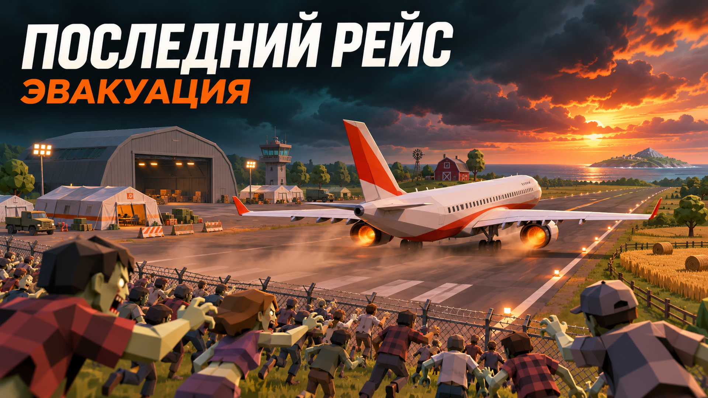

# Последний рейс: Эвакуация (FlyCrash, Roblox)



Аркадный авиасимулятор для Roblox. Город захватили зомби: забирай выживших пассажиров в аэропорту, улетай на остров-убежище и зарабатывай на новые самолёты. По пути друзья могут устроить тебе хаос: оторвать двигатель, натравить гусей, поджечь салон.

## Как запустить

1. Скачай `FlyCrash.rbxlx`.
2. В Roblox Studio выбери **File → Open from File** и нажми **Play**.

Чтобы деньги сохранялись в Studio, включи **Game Settings → Security → Enable Studio Access to API Services**. В опубликованной игре сохранение работает само.

## Промокоды

В ангаре кнопка **КОДЫ**. Сейчас работают: `666` (+$666), `FLYCRASH` (+$1000), `ZOMBIE` (+$500), `GLEBOVIC` (+$2026). Каждый игрок активирует код один раз. Код из одних цифр (например `1250`) даёт ровно столько денег — но только владельцу игры и в Studio (настройка `NUMERIC_CODES_FOR_OWNER`). Свои коды добавляются в таблицу `CODES` в начале `src/server/FlyCrashServer.lua`.

## Как играть

- При входе открывается **ангар**. Выбери самолёт (← → или 1–9), окраску и нажми **ЛЕТЕТЬ** (Enter).
- Самолёт стоит на рулёжке. **Пассажиры** бегут к нему с перрона, пока он стоит на земле. Зомби охотятся за ними, и укушенный сам становится зомби. Если зомби добежал до самолёта, он съедает пассажиров в салоне.
- Пока стоишь, идёт отсчёт **орды**: когда он кончается, толпа зомби бежит к самолёту. Если у самолёта соберётся 6 зомби и они продержатся 4 секунды — самолёт захвачен. Не жди слишком долго!
- Взлетай и лети на восток, к **острову-убежищу** с зелёным маяком. Сядь и остановись: каждый пассажир платит **$25**.
- На деньги покупай самолёты побольше: чем больше салон, тем больше заработок за рейс.

| Самолёт | Цена | Мест |
|---|---|---|
| Cessna 172 | бесплатно | 4 |
| Challenger 650 | $300 | 10 |
| ATR 72 | $600 | 30 |
| Boeing 737 | $1 250 | 60 |
| Boeing 747 | $4 000 | 120 |
| Ан-225 «Мрия» | $6 000 | 200 |

**Управление:** G — шасси (убранные дают +12% скорости, садиться без них нельзя), W/S — газ, A/D — поворот, стрелки — нос вверх/вниз, R — заново, F — выйти, H — ангар, Shift — бег. На телефоне — экранные кнопки. Кнопка **АВТОВЗЛЁТ** поднимет самолёт сама.

**Пульт ХАОС:** отрыв двигателей, пожар, потеря управления, взрыв, гуси, дрон, встречный борт, гроза.

## Устройство проекта

```
FlyCrash.rbxlx               готовое место — открывай в Studio
src/server/FlyCrashServer.lua   полёты, ангар, магазин, хаос, пассажиры, сохранения
src/server/OutbreakServer.lua   пассажиры-NPC и зомби
src/server/WorldBuilder.lua     ландшафт: поля, горы, море, остров, атмосфера
src/server/TrafficServer.lua    машины на дорогах
src/client/FlyCrashClient.lua   интерфейс: ангар, приборы, подсказки, управление
src/shared/FlyCrashShared.lua   ливреи и общие настройки
tools/build_place.py            генератор FlyCrash.rbxlx (мир + скрипты)
tools/fleet.py                  самолёты, собранные из деталей
```

Чтобы пересобрать место после правок скриптов или мира, запусти `python3 tools/build_place.py`: он перезапишет `FlyCrash.rbxlx`.

Настройки (скорости, цены, награды, число зомби) лежат в таблицах `CFG` в начале каждого скрипта.

Если у тебя своё место с самолётами из Toolbox, пересобери и вставь в него свежие скрипты:
`python3 tools/update_my_place.py "путь/к/твоему_месту.rbxlx"` (копия старого файла сохранится рядом как `.bak`).

### Продолжить в Cursor

1. Склонируй репозиторий и открой папку в Cursor.
2. Правь скрипты в `src/` (язык Luau). Мир и постройки (полосы, остров, здания) задаются в `tools/build_place.py`.
3. После правок: `python3 tools/build_place.py`, затем, если нужно, `tools/update_my_place.py` для своего места.
4. Открой .rbxlx в Roblox Studio → Play. Сообщения игры смотри в окне Output (строки начинаются с `FlyCrash`).

Полезно знать:
- Самолёты сервер двигает сам (`PivotTo` каждый кадр), без физики Roblox; телеметрия передаётся клиенту через атрибуты модели (`Speed`, `Altitude`, `State`, `EngineOn`, `Throttle`).
- Винты крутит клиент: сервер помечает детали атрибутами `FCProp`, `FCBase`, `FCHub`, `FCGroup`. Если винт модели не нашёлся, переименуй его деталь в `Prop`.
- Полосы и перроны у земли: WorldBuilder при запуске вырезает под ними ландшафт и утолщает плиты, иначе трава вылезает поверх.
- Ворота глиссады (как ILS) рисует клиент перед ближайшей полосой, к которой летит самолёт.

### Свои самолёты

Положи любую модель самолёта в папку **Workspace → Hangar** (или просто в Workspace). Сервер сам найдёт нос, кресло пилота и двигатели, а все скрипты из модели удалит. Паспорт можно задать атрибутами модели: `Price`, `TopSpeed`, `Capacity`, `Category`, `Description`, `Engines`, `FirstFlight`. Если самолёт летит хвостом вперёд, поставь `NoseYaw` = 180.

### Звуки

Загрузи свои звуки через **Asset Manager → Bulk Import** и вставь их ID в `SoundId` объектов в **ReplicatedStorage → FlyCrashSounds**: EngineLoop, EngineStart, Takeoff, Landing, Explosion, Crash, Fire, Alarm, Geese, Pilots, Stewardess, Coin, Gear, PullUp, Drone, EngineFail, Tower.

Звуки играют сами: стюардесса — перед взлётом и когда салон полон; Takeoff — на разбеге; Pilots — раз в ~75 с в полёте; PullUp — низко и быстрое снижение; EngineFail — отказ двигателя; Drone — летящий дрон; Tower — фон диспетчеров у башни.
